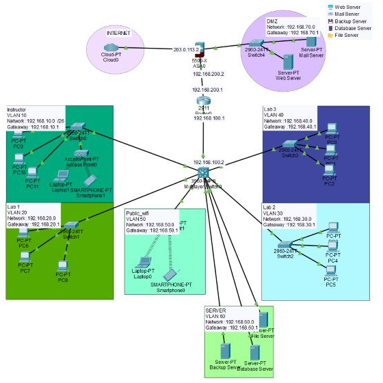

# Secure Network Design & Simulation

A segmented campus network designed and simulated in **Cisco Packet Tracer**.
Departments, labs, guest Wi-Fi, and servers each sit in their own VLAN, and public-facing servers are placed in a separate DMZ behind a firewall.

## Network layout

Traffic flows: **Internet → ASA firewall → Router → Multilayer switch → VLANs**.
The firewall also connects the **DMZ**, which keeps public servers away from the internal network.

| Device | Model | Addresses |
|---|---|---|
| Firewall | Cisco ASA 5506-X | Outside `203.0.113.2` · Inside `192.168.200.2` |
| Router | Cisco 2911 | `192.168.200.1` · `192.168.100.1` |
| Core switch | Cisco 3560 multilayer switch | `192.168.100.2` |
| Access switches | Cisco 2960-24TT | One per VLAN / DMZ |

## VLANs and subnets

| VLAN | Segment | Network | Gateway | Devices |
|---|---|---|---|---|
| 10 | Instructor | `192.168.10.0` | `192.168.10.1` | PCs, laptop, smartphone, access point |
| 20 | Lab 1 | `192.168.20.0` | `192.168.20.1` | PCs |
| 30 | Lab 2 | `192.168.30.0` | `192.168.30.1` | PCs |
| 40 | Lab 3 | `192.168.40.0` | `192.168.40.1` | PCs |
| 50 | Public Wi-Fi | `192.168.50.0` | `192.168.50.1` | Wireless guests |
| 60 | Servers | `192.168.60.0` | `192.168.60.1` | File, Backup, Database servers |
| — | DMZ | `192.168.70.0` | `192.168.70.1` | Web, Mail servers |

## Security concepts applied
- **Network segmentation:** each group gets its own VLAN, so a problem in one segment does not spread easily to others.
- **Guest isolation:** public Wi-Fi users are kept in a separate VLAN from staff and labs.
- **DMZ:** internet-facing servers (Web, Mail) sit outside the internal network.
- **Perimeter firewall:** a Cisco ASA sits between the internet and every internal segment.
- **Protected internal servers:** file, backup, and database servers have their own VLAN.

## How to open
1. Install [Cisco Packet Tracer](https://www.netacad.com/cisco-packet-tracer).
2. Download `Secure Network Design.pkt` from this repository.
3. Open it in Packet Tracer and use **Simulation** mode to follow packets between VLANs.

## Tools
Cisco Packet Tracer

## Author
[Sara Aljohani](https://github.com/xSarah11)
